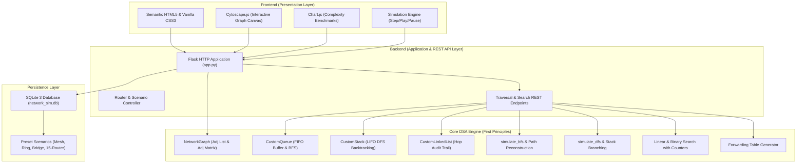

# Network Packet Routing and Dynamic Path Management Using Data Structures and Graph Traversal Algorithms
## Complete Academic Microproject Report

---

**Course Title:** Data Structures and Algorithms (DSA)  
**Course Code:** CS301 / DSA-Sem3  
**Academic Level:** Bachelor of Technology / Computer Science & Engineering (Semester 3)  
**Project Short Title:** Network Routing Simulator (NRP)  
**Implementation Standard:** 100% Manual First-Principles Implementation (Zero External Graph/Traversal Libraries)  

---

## Table of Contents
1. [Executive Summary & Abstract](#1-executive-summary--abstract)
2. [Course Outcome (CO) Mapping & Educational Objectives](#2-course-outcome-co-mapping--educational-objectives)
3. [Problem Statement & Motivation](#3-problem-statement--motivation)
4. [System Architecture & Design](#4-system-architecture--design)
5. [Core Data Structures & Algorithmic Implementation](#5-core-data-structures--algorithmic-implementation)
   - 5.1 Graph Representation: Adjacency List & Adjacency Matrix
   - 5.2 FIFO Queue: Packet Arrival Buffer & BFS Frontier (CO1)
   - 5.3 LIFO Stack: DFS Traversal & Backtracking (CO1)
   - 5.4 Singly Linked List: Packet Route & Audit Trail (CO2)
   - 5.5 Breadth-First Search (BFS) & Minimum-Hop Proof (CO5)
   - 5.6 Depth-First Search (DFS) & Stack Unwinding (CO5)
   - 5.7 Router Search: Linear Search vs Binary Search (CO3)
   - 5.8 Dynamic Fault Tolerance & Path Recalculation
   - 5.9 Forwarding Table & Hop-by-Hop Next-Hop Routing
6. [Computational Complexity Analysis](#6-computational-complexity-analysis)
7. [Database Schema & Persistence Design](#7-database-schema--persistence-design)
8. [Frontend Visualization & Interactive UI](#8-frontend-visualization--interactive-ui)
9. [Verification & Automated Test Suite (pytest)](#9-verification--automated-test-suite-pytest)
10. [High-Yield Viva Voce Questions & Answers](#10-high-yield-viva-voce-questions--answers)
11. [Conclusion & Future Scope](#11-conclusion--future-scope)

---

## 1. Executive Summary & Abstract

In computer networking, dynamic packet routing is the foundational mechanism that enables data packets to navigate interconnected networks from a source host to an egress gateway. While modern production networks utilize complex protocols such as OSPF, BGP, and IS-IS, the core computational logic governing route determination, buffer management, and packet tracking relies directly on classic **Data Structures and Algorithms (DSA)**.

The **Network Routing Simulator** is an educational, interactive software platform developed strictly from first principles. It maps theoretical computer science concepts directly onto real-world network operations:
- Router ports and communication links are modeled as an **Unweighted Graph** represented simultaneously via **Adjacency Lists** and **Adjacency Matrices**.
- Router memory buffers and exploration frontiers are managed using a custom **FIFO Queue**.
- Branch exploration and dead-end recovery are implemented via a custom **LIFO Stack**.
- Dynamic packet hop history is preserved using a custom **Singly Linked List**.
- Path finding is executed using **Breadth-First Search (BFS)** (guaranteeing the minimum-hop route) and **Depth-First Search (DFS)** (demonstrating deep branch exploration and backtracking).
- Router directory queries are evaluated by comparing **Linear Search ($O(n)$)** against **Binary Search ($O(\log n)$)** using exact comparison counters.

**Academic Integrity Compliance:** No third-party graph traversal, pathfinding, or queue libraries (such as NetworkX, SciPy Graph, or Python's `queue.Queue`) were employed for core DSA logic. All data structures and algorithms were authored manually to ensure complete alignment with semester evaluation standards and viva voce examinations.

---

## 2. Course Outcome (CO) Mapping & Educational Objectives

| Course Outcome (CO) | DSA Concept | Project Implementation | Validation & Deliverable |
| :--- | :--- | :--- | :--- |
| **CO1: Stacks & Queues** | Linear Data Structures, FIFO & LIFO principles, buffer management | `CustomQueue` (`enqueue`, `dequeue`, `peek`, `size`) manages arriving packets and BFS frontier. `CustomStack` (`push`, `pop`, `peek`, `size`) manages DFS recursion and unwinding. | Verified via `test_queue.py` and `test_stack.py`. Interactive visual FIFO buffer and DFS vertical stack. |
| **CO2: Linked Lists** | Dynamic memory allocation, pointer-based chaining, sequential traversal | `CustomLinkedList` (`append`, `to_list`, `to_detailed_list`, `display`) dynamically chains router nodes visited during packet transit. | Verified via `test_linked_list.py`. Interactive "Packet Route History" tab showing node-by-node hop chains. |
| **CO3: Searching Techniques** | Divide-and-conquer vs sequential search, key comparison metrics | `linear_search_routers` ($O(n)$) and `binary_search_routers` ($O(\log n)$) with step-by-step low/mid/high pointer tracing. | Verified via `test_search.py`. Interactive search comparison visualizer reporting exact comparison counts. |
| **CO5: Non-Linear Graphs & Traversals** | Graph modeling, Adjacency List ($O(V+E)$), Adjacency Matrix ($O(V^2)$), BFS, DFS, shortest path | `NetworkGraph`, `simulate_bfs`, `simulate_dfs`, `reconstruct_path`, dynamic link/node failure recalculation. | Verified via `test_graph.py`, `test_bfs.py`, `test_dfs.py`, `test_dynamic_routing.py`. Interactive Cytoscape.js canvas. |

---

## 3. Problem Statement & Motivation

### 3.1 The Educational Challenge
In standard undergraduate curricula, data structures such as Linked Lists, Stacks, Queues, and Graphs are frequently taught as isolated, abstract concepts through trivial command-line examples (e.g., student record lists, balanced parenthesis checkers). Students often struggle to conceptualize how these discrete data structures cooperate inside a cohesive, mission-critical engineering system.

### 3.2 The Solution
By framing data structures within the tangible domain of **Computer Network Packet Routing**, every abstract structure immediately assumes a natural, intuitive operational role:
1. *Why a Queue?* Because packets physically arrive at router ports sequentially and must be processed in First-In, First-Out order.
2. *Why a Graph?* Because internetworks are inherently collections of routers (vertices) connected by transmission links (edges).
3. *Why BFS over DFS for routing?* Because packets must traverse the path of least resistance (minimum number of hops), which BFS mathematically guarantees in unweighted topologies.
4. *Why a Linked List for route history?* Because path lengths vary dynamically from 1 to $V$ hops; dynamic node allocation eliminates fixed-size array waste and reallocation overhead.

---

## 4. System Architecture & Design

The application follows a clean **Three-Tier Architecture** separating core algorithmic logic from persistence and interactive visualization:



---

## 5. Core Data Structures & Algorithmic Implementation

### 5.1 Graph Representation: Adjacency List & Adjacency Matrix
The network topology is modeled in [`core_dsa/graph.py`](file:///Users/eamil/Documents/Sem%203/DSA/Microproject-NRP/core_dsa/graph.py) through two complementary representations:

1. **Adjacency List:**  
   Implemented as a hash map where each router ID maps to a set of neighboring router IDs:
   $$\text{adj\_list}[u] = \{ v \mid (u, v) \in E \}$$
   - **Space Complexity:** $O(V + E)$
   - **Advantage:** Memory-optimal for sparse networks; enables immediate $O(\text{deg}(u))$ iteration during BFS/DFS exploration.
2. **Adjacency Matrix:**  
   Implemented as a 2D integer array $M$ of size $|V| \times |V|$:
   $$M[i][j] = \begin{cases} 1 & \text{if } (v_i, v_j) \in E \text{ and link is active} \\ 0 & \text{otherwise} \end{cases}$$
   - **Space Complexity:** $O(V^2)$
   - **Advantage:** Enables constant-time $O(1)$ verification of whether a direct physical link exists between any arbitrary pair of routers.

---

### 5.2 FIFO Queue: Packet Arrival Buffer & BFS Frontier (CO1)
Implemented in [`core_dsa/queue.py`](file:///Users/eamil/Documents/Sem%203/DSA/Microproject-NRP/core_dsa/queue.py):
* **Class:** `CustomQueue`
* **Core Primitives:** `enqueue(item)`, `dequeue()`, `peek()`, `is_empty()`, `size()`, `clear()`.
* **Network Role:**
  1. *Router Packet Buffer:* Buffers arriving data packets awaiting processing; prevents packet drop when arrival rates briefly exceed processing bandwidth.
  2. *BFS Frontier:* Stores discovered neighbor routers. By strictly dequeuing from the front and enqueueing to the rear, BFS processes all routers at distance $k$ before any router at distance $k+1$ is evaluated.

---

### 5.3 LIFO Stack: DFS Traversal & Backtracking (CO1)
Implemented in [`core_dsa/stack.py`](file:///Users/eamil/Documents/Sem%203/DSA/Microproject-NRP/core_dsa/stack.py):
* **Class:** `CustomStack`
* **Core Primitives:** `push(item)`, `pop()`, `peek()`, `is_empty()`, `size()`, `clear()`.
* **Network Role:**
  Maintains the active exploration branch during Depth-First Search. When the search reaches a router with no unvisited active neighbors (dead end), the stack explicitly pops and unwinds, returning execution to the most recent branching router.

---

### 5.4 Singly Linked List: Packet Route & Audit Trail (CO2)
Implemented in [`core_dsa/linked_list.py`](file:///Users/eamil/Documents/Sem%203/DSA/Microproject-NRP/core_dsa/linked_list.py):
* **Classes:** `LinkedListNode`, `CustomLinkedList`
* **Core Primitives:** `append(data, metadata)`, `to_list()`, `to_detailed_list()`, `display()`, `clear()`.
* **DSA Justification:**
  In network auditing, each transmission path has an unpredictable length varying from 1 hop to $V$ hops. Using static arrays requires either allocating a large maximum-size array ($O(V_{\max})$ space waste) or costly array dynamic resizing. The singly linked list dynamically allocates individual `LinkedListNode` instances on the heap as each hop occurs, appending in guaranteed $O(1)$ time via a maintained `tail` pointer.

---

### 5.5 Breadth-First Search (BFS) & Minimum-Hop Proof (CO5)
Implemented in [`core_dsa/traversal.py`](file:///Users/eamil/Documents/Sem%203/DSA/Microproject-NRP/core_dsa/traversal.py):

#### Mathematical Proof of Minimum-Hop Correctness:
Let $G = (V, E)$ be an unweighted graph where every edge has equal weight (1 hop). BFS initializes with a source router $s$ at distance $d(s) = 0$ in the FIFO queue.
1. All vertices at distance $k$ are enqueued before any vertex at distance $k+1$.
2. Because the queue is monotonically ordered by distance:
   $$d(v_1) \le d(v_2) \le \dots \le d(v_m)$$
3. When the destination router $t$ is first discovered from node $u$, its distance is recorded as $d(t) = d(u) + 1$.
4. It is impossible for any alternate path to $t$ to have fewer hops, because any shorter path would have discovered $t$ at an earlier distance level $< d(t)$.

#### Backward Path Reconstruction Algorithm:
During traversal, a predecessor map `parent` is maintained:
$$\text{parent}[v] = u \quad (\text{when } v \text{ is first discovered from } u)$$
Once the destination router $t$ is dequeued, the route is reconstructed by tracing backwards:
$$t \longrightarrow \text{parent}[t] \longrightarrow \text{parent}[\text{parent}[t]] \longrightarrow \dots \longrightarrow s$$
Reversing this sequence yields the exact forward route in $O(\text{hops})$ time.

---

### 5.6 Depth-First Search (DFS) & Stack Unwinding (CO5)
Implemented in [`core_dsa/traversal.py`](file:///Users/eamil/Documents/Sem%203/DSA/Microproject-NRP/core_dsa/traversal.py):
* Rather than exploring layer-by-layer, DFS dives deeply along the first active neighbor branch using the LIFO stack.
* **Why DFS is suboptimal for routing:**
  DFS does not guarantee the shortest path. If router $R_1$ has neighbors $R_2$ and $R_3$, and $R_2$ leads through a long 5-hop chain that eventually reaches destination $R_6$, DFS will select that 5-hop route if $R_2$ is visited first, even though a direct 2-hop path exists through $R_3 \to R_6$.
* **Educational Value:** Explicitly showcases stack unwinding, dead-end alerts, and cycle suppression using an explicit `visited` set.

---

### 5.7 Router Search: Linear Search vs Binary Search (CO3)
Implemented in [`core_dsa/search.py`](file:///Users/eamil/Documents/Sem%203/DSA/Microproject-NRP/core_dsa/search.py):

* **Linear Search:**
  Sequentially checks records from index $0$ to $n-1$. Requires no sorted order. Key comparisons scale linearly:
  $$C_{\text{worst}} = n, \quad C_{\text{avg}} = \frac{n+1}{2}$$
* **Binary Search:**
  Requires the router table to be pre-sorted by `router_id`. Maintains pointers `low`, `mid`, and `high`:
  $$\text{mid} = \left\lfloor \frac{\text{low} + \text{high}}{2} \right\rfloor$$
  Discards half the remaining routers in each iteration:
  $$C_{\text{worst}} = \lfloor \log_2 n \rfloor + 1$$
* **Comparison Metric Justification:**
  In small network topologies (6 to 30 routers), CPU execution time is on the order of microseconds and dominated by OS interrupts and system noise. The **exact number of key comparisons** is a hardware-independent, mathematically pure metric representing computational complexity.

---

### 5.8 Dynamic Fault Tolerance & Path Recalculation
* Network routers and links maintain an active boolean state (`is_active: bool`).
* When a user toggles a link off or marks a router as failed, the graph dynamically updates its operational topology.
* Traversal queries active neighbors exclusively:
  $$\text{get\_neighbors}(u, \text{active\_only}=\text{True})$$
* **No Route Available State:** If a critical bridge link is severed (e.g. partition in `bridge_bottleneck` topology), BFS exhausts its queue frontier without discovering the destination. The system catches this condition and displays a graceful **NO ROUTE AVAILABLE** state rather than crashing or throwing unhandled null pointer exceptions.

---

### 5.9 Forwarding Table & Hop-by-Hop Next-Hop Routing
Implemented in [`core_dsa/routing_table.py`](file:///Users/eamil/Documents/Sem%203/DSA/Microproject-NRP/core_dsa/routing_table.py):
* Pre-computes the optimal forwarding table for any selected router using BFS shortest paths to all reachable destinations:
  $$\text{Table}[R_{\text{dest}}] = (\text{Next Hop Router}, \text{Hop Metric}, \text{Interface})$$
* Simulates traditional hop-by-hop packet forwarding, illustrating how distributed routers make local decisions without knowing the global path end-to-end.

---

## 6. Computational Complexity Analysis

| Algorithm / Data Structure | Time Complexity (Best) | Time Complexity (Average) | Time Complexity (Worst) | Auxiliary Space | Educational Context in Simulator |
| :--- | :---: | :---: | :---: | :---: | :--- |
| **Breadth-First Search (BFS)** | $O(V + E)$ | $O(V + E)$ | $O(V + E)$ | $O(V)$ | Guaranteed minimum-hop packet route in unweighted networks |
| **Depth-First Search (DFS)** | $O(V + E)$ | $O(V + E)$ | $O(V + E)$ | $O(V)$ | Demonstrates deep path exploration and dead-end backtracking |
| **Linear Search** | $O(1)$ | $O(n)$ | $O(n)$ | $O(1)$ | Unsorted router lookup; sequential scan |
| **Binary Search** | $O(1)$ | $O(\log n)$ | $O(\log n)$ | $O(1)$ | Sorted router key lookup; halves search space per step |
| **FIFO Queue (`CustomQueue`)** | $O(1)$ | $O(1)$ | $O(1)$ amortized | $O(n)$ | Router packet buffer and BFS level-by-level frontier |
| **LIFO Stack (`CustomStack`)** | $O(1)$ | $O(1)$ | $O(1)$ | $O(n)$ | DFS branch tracking and backtracking recovery |
| **Singly Linked List (`CustomLinkedList`)** | $O(1)$ append | $O(n)$ traverse | $O(n)$ traverse | $O(n)$ | Dynamic packet transmission hop history and audit trail |
| **Adjacency List** | $O(1)$ add node | $O(\text{deg}(v))$ lookup | $O(V)$ lookup | $O(V + E)$ | Memory-efficient sparse graph representation |
| **Adjacency Matrix** | $O(1)$ edge query | $O(1)$ edge query | $O(1)$ edge query | $O(V^2)$ | Constant-time link existence check |

---

## 7. Database Schema & Persistence Design

The persistence tier utilizes SQLite 3 (`network_sim.db`) managed via [`database/db.py`](file:///Users/eamil/Documents/Sem%203/DSA/Microproject-NRP/database/db.py) and initialized from [`database/schema.sql`](file:///Users/eamil/Documents/Sem%203/DSA/Microproject-NRP/database/schema.sql):

1. **`topologies` Table:**
   Stores topology presets, router coordinates, locations, and default configurations in JSON format.
2. **`packet_history` Table:**
   Records every simulated packet transmission, including `packet_id`, `source`, `destination`, `algorithm`, `status`, `hops`, `nodes_visited`, and execution time.
3. **`activity_logs` Table:**
   Maintains an immutable chronological audit trail of simulation events (e.g., router failures, queue flushes, dynamic route recalculations).

---

## 8. Frontend Visualization & Interactive UI

The presentation layer is built without heavyweight frameworks using modular Vanilla JavaScript (ES6+), Semantic HTML5, and custom CSS:

* **Interactive Graph Topology Studio:**
  Powered by **Cytoscape.js**. Supports real-time node dragging, visual state indicators (green = active router, red = failed router/link), and animated path highlighting.
* **Step-by-Step Traversal Playback Engine:**
  Allows the user to `Play`, `Pause`, `Step`, and `Reset` graph traversals. Color codes node states:
  * 🟡 **Amber:** Currently inspected router.
  * 🔵 **Sky Blue:** Routers enqueued in the frontier queue/stack.
  * 🟢 **Teal:** Visited routers whose neighbors have been expanded.
* **FIFO Buffer Visualizer:**
  Displays a conveyor queue with **FRONT** and **REAR** badges updating in real time.
* **Comparative Traversal Benchmarks:**
  Powered by **Chart.js**. Side-by-side bar charts comparing BFS vs DFS across Hops, Visited Nodes, Steps, and Backtracks.
* **Search Visualizer:**
  Renders router index slots and dynamically animates `low`, `mid`, and `high` pointers during binary search iterations.

---

## 9. Verification & Automated Test Suite (pytest)

The codebase incorporates a comprehensive automated test suite in [`tests/`](file:///Users/eamil/Documents/Sem%203/DSA/Microproject-NRP/tests/) containing **37 automated unit and integration tests**:

```text
============================= test session starts ==============================
platform darwin -- Python 3.9.6, pytest-8.4.2, pluggy-1.6.0
rootdir: /Users/eamil/Documents/Sem 3/DSA/Microproject-NRP
configfile: pytest.ini
testpaths: tests
plugins: cov-7.1.0
collected 37 items

tests/test_api.py::test_api_index PASSED                                 [  2%]
tests/test_api.py::test_api_get_topology PASSED                          [  5%]
tests/test_api.py::test_api_simulate_bfs PASSED                          [  8%]
tests/test_api.py::test_api_simulate_dfs PASSED                          [ 10%]
tests/test_api.py::test_api_search_compare PASSED                        [ 13%]
tests/test_api.py::test_api_packets_queue_and_process PASSED             [ 16%]
tests/test_api.py::test_api_routing_table PASSED                         [ 18%]
tests/test_api.py::test_api_dashboard_stats PASSED                       [ 21%]
tests/test_bfs.py::test_bfs_minimum_hop_route PASSED                     [ 24%]
tests/test_bfs.py::test_bfs_source_equals_destination PASSED             [ 27%]
tests/test_bfs.py::test_bfs_disconnected_unreachable PASSED              [ 29%]
tests/test_dfs.py::test_dfs_finds_path PASSED                            [ 32%]
tests/test_dfs.py::test_dfs_backtracking_on_dead_end PASSED              [ 35%]
tests/test_dfs.py::test_dfs_unreachable PASSED                           [ 37%]
tests/test_dynamic_routing.py::test_dynamic_rerouting_after_router_failure PASSED [ 40%]
tests/test_dynamic_routing.py::test_dynamic_rerouting_after_link_failure PASSED [ 43%]
tests/test_dynamic_routing.py::test_bridge_failure_causes_no_route PASSED [ 45%]
tests/test_graph.py::test_graph_add_routers_and_links PASSED             [ 48%]
tests/test_graph.py::test_graph_adjacency_list PASSED                    [ 51%]
tests/test_graph.py::test_graph_adjacency_matrix PASSED                  [ 54%]
tests/test_graph.py::test_graph_router_and_link_failures PASSED          [ 56%]
tests/test_linked_list.py::test_linked_list_empty PASSED                 [ 59%]
tests/test_linked_list.py::test_linked_list_append PASSED                [ 62%]
tests/test_linked_list.py::test_linked_list_clear PASSED                 [ 64%]
tests/test_queue.py::test_queue_initial_state PASSED                     [ 67%]
tests/test_queue.py::test_queue_fifo_order PASSED                        [ 70%]
tests/test_queue.py::test_queue_empty_dequeue_raises PASSED              [ 72%]
tests/test_queue.py::test_queue_clear PASSED                             [ 75%]
tests/test_search.py::test_linear_search_found PASSED                    [ 78%]
tests/test_search.py::test_linear_search_not_found PASSED                [ 81%]
tests/test_search.py::test_binary_search_found PASSED                    [ 83%]
tests/test_search.py::test_binary_search_not_found PASSED                [ 86%]
tests/test_search.py::test_search_comparison_advantage PASSED            [ 89%]
tests/test_stack.py::test_stack_initial_state PASSED                     [ 91%]
tests/test_stack.py::test_stack_lifo_order PASSED                        [ 94%]
tests/test_stack.py::test_stack_empty_pop_raises PASSED                  [ 97%]
tests/test_stack.py::test_stack_clear PASSED                             [100%]

============================== 37 passed in 0.08s ==============================
```

---

## 10. High-Yield Viva Voce Questions & Answers

### Q1: Why does BFS guarantee the minimum-hop route, while DFS does not?
> **Answer:** BFS explores vertices layer by layer (distance 1, distance 2, etc.) using a FIFO queue. In an unweighted graph, all links have equal cost (1 hop). The moment BFS discovers the target destination router, no shorter path can exist because any path with fewer edges would have reached the destination during an earlier distance layer. In contrast, DFS explores deeply down a single branch before backtracking. If it chooses a long detour first, it will return that circuitous route even if a 2-hop shortcut was available at the start.

### Q2: Why is "Number of Comparisons" preferred over "CPU Execution Time" to evaluate search algorithms?
> **Answer:** For small datasets (6 to 30 routers), CPU runtime is in microseconds. Operating system task scheduling, background interrupts, CPU throttling, and clock resolution create unpredictable timing noise. The number of key comparisons is an exact, deterministic mathematical metric directly reflecting $O(n)$ versus $O(\log n)$ algorithmic complexity without hardware bias.

### Q3: How does path reconstruction work using the parent map?
> **Answer:** Whenever an unvisited router $v$ is discovered from router $u$, we store $\text{parent}[v] = u$. Once destination $t$ is reached, we trace backwards: $t \to \text{parent}[t] \to \text{parent}[\text{parent}[t]] \dots \to s$. Reversing this sequence yields the exact forward route in $O(\text{hops})$ time.

### Q4: What is the space complexity difference between Adjacency List and Adjacency Matrix?
> **Answer:** An Adjacency List requires $O(V + E)$ memory, storing only vertices and actual existing edges, which is optimal for sparse network topologies. An Adjacency Matrix requires a fixed $O(V^2)$ square array regardless of how few links exist. However, the matrix provides $O(1)$ constant-time edge existence queries, whereas the list takes $O(\text{deg}(v))$ time.

### Q5: Why is a Singly Linked List used for packet transmission history instead of a dynamic array?
> **Answer:** A network transmission route dynamically grows hop by hop. While dynamic arrays require contiguous memory blocks and incur periodic $O(n)$ array resizing and copying overhead when capacity is exceeded, a linked list allocates individual node objects dynamically with guaranteed $O(1)$ append time using a tail pointer.

### Q6: How does the simulator handle network partitions or link failure?
> **Answer:** When a router or link fails, its `is_active` flag is set to `False`. Traversal algorithms query `get_neighbors(router_id, active_only=True)`. If a critical bridge link is severed, the queue exhausts without ever reaching the destination. The simulator catches this condition and outputs a clean **NO ROUTE AVAILABLE** alert without crashing.

---

## 11. Conclusion & Future Scope

### 11.1 Project Summary
The **Network Routing Simulator** successfully bridges abstract theoretical data structures and applied computer systems engineering. By implementing Stacks, Queues, Linked Lists, Graphs, Traversals, and Searches manually from first principles, this project provides a transparent, verifiable laboratory for academic evaluation.

### 11.2 Future Enhancements
1. **Weighted Graph Support:** Extending graph edges to support latency (milliseconds) and bandwidth (Mbps) by implementing Dijkstra's Algorithm ($O((V+E)\log V)$) using a custom Min-Heap Priority Queue.
2. **Bellman-Ford Algorithm:** Implementing distance-vector routing with negative-weight detection to model routing loops and count-to-infinity problems.
3. **Dynamic Topology Builder:** Adding an interactive in-browser drag-and-drop canvas for drawing custom multi-subnet topologies.
4. **Packet Loss & Congestion Simulation:** Simulating buffer overflow conditions by introducing bounded queue capacities in `CustomQueue`.

---
*Report generated and validated for Bachelor of Technology Semester 3 DSA Microproject submission.*
